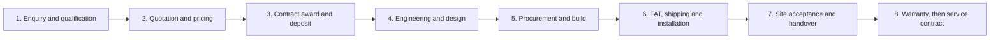

> **Fictional case study.** All names, figures and transactions are invented for educational purposes.
# Company Profile

## 1. Business Overview
| Item | Detail |
|---|---|
| Company name | Mirdain Robotics Systems Ltd (fictional) |
| Headquarters | Coventry, West Midlands, UK |
| Founded | 2009 |
| Legal form | Private limited company (Ltd), privately owned |
| Sector | Industrial automation and robotics integration |

**Mirdain Robotics Systems Ltd** is a UK automation integrator that designs, supplies and installs robotic production cells, combining industrial robots, machine vision and AI-driven quality inspection to help manufacturers increase output, consistency and safety. Beyond installation, it supports customers throughout the life of their equipment through service and maintenance contracts, spare parts supply, and AI-enabled predictive maintenance and remote monitoring.

## 2. Company Size
### Key metrics

| Metric | Mirdain Robotics Systems Ltd (fictional) |
|---|---|
| Latest historical year | FY2025 (year ended 31 December 2025) |
| Revenue | £9.0m |
| Gross profit / margin | £2.4m / 27.0% |
| EBITDA / margin | £0.7m / 8.0% |
| Total employees | 32 |
| Site | One office and engineering lab in Coventry; no workshop (assembly is outsourced) |
| Ownership | Privately owned Ltd |

### Headcount (32)

| Function | Headcount | Notes |
|---|---|---|
| Engineering (mechanical, electrical, software/vision/AI) | 20 | Largest group; chargeable to projects (COGS) |
| Project managers | 6 | Also cover procurement, supply chain and subcontractor/service coordination |
| Finance | 3 | Also cover admin, HR and payroll support |
| Senior leadership (MD, Technical Director, Commercial Director) | 3 | The Commercial Director manages the sales agents and bids |
| **Total** | **32** | |

### What is outsourced

| Activity | How it is delivered | Where it appears in the model |
|---|---|---|
| Assembly and installation | Subcontractors | COGS: subcontractor costs |
| Service and maintenance | Subcontracted field service partners | COGS: subcontractor costs |
| Sales | Outside agents, paid commission (assume about 2.5% of revenue) | OPEX: commissions |
| IT | Managed IT provider | OPEX: IT services |

*Sizing is calibrated to publicly available benchmarks for UK and international automation integrators. All figures for Mirdain are fictional.*

## 3. Operating Model
### Revenue streams

| Stream | Description | Indicative share of FY2025 revenue |
|---|---|---|
| Robotics Systems Projects | Design, supply and commissioning of complete robotic production cells, including robots, tooling, safety systems, controls and machine vision | ~60% (£5.4m) |
| Engineering & Integration | Chargeable engineering services: feasibility studies, cell design, robot programming, AI/vision integration and upgrades to existing lines | ~15% (£1.35m) |
| Service & Maintenance | Planned maintenance, breakdown cover, remote monitoring and AI-enabled predictive maintenance, delivered with subcontracted field-service partners | ~15% (£1.35m) |
| Spare Parts | Supply of robot spares, grippers, sensors, cameras and consumables to installed-base customers | ~10% (£0.9m) |

### How the company makes money

- **Projects** are fixed-price and billed on milestones, typically a deposit on order, then design approval, equipment delivery, factory acceptance test and site acceptance. Revenue is recognised as work progresses, while cash follows the billing milestones.
- **Engineering & Integration** is billed on time-and-materials or fixed-fee work packages, often as a lead-in to a full project.
- **Service & Maintenance** is mainly annual contracts billed in advance or quarterly, giving recurring, more predictable revenue and a route to long-term customer relationships.
- **Spare Parts** are transactional sales, with a margin on resale and higher volumes as the installed base grows.
- Overall, about 60% of revenue is project-driven and lumpy, and about 40% is shorter-cycle or recurring. Growing the service base is a strategic aim, because it steadies earnings.

### Supply chain and FX exposure

- Robots, controllers, vision systems and key components are bought from European and Asian OEMs (for example, German, Swiss and Japanese manufacturers), plus UK distributors for standard electrical and mechanical items.
- Purchases are often priced in **EUR** and **JPY**, while customers are invoiced in **GBP**. A weaker pound raises costs between quotation and purchase. Mirdain manages this through quotation validity periods, contingency in pricing and, where appropriate, forward contracts. This is tested in the Project 3 sensitivities.
- Project managers also handle procurement and supply chain, which keeps the team small but makes them a key capacity constraint.
- Equipment is bought against customer orders, so inventory is limited, but supplier payments often fall due before customer milestone receipts. This is a working-capital pressure point.

### Delivery model

- **In-house:** 20 engineers (mechanical, electrical, software, vision/AI) design and programme the cells. Six project managers run delivery, procurement and subcontractor coordination.
- **Outsourced:** assembly and installation are carried out by subcontractors, and service work is delivered through field-service partners. This keeps fixed costs low and lets capacity flex with order volumes.
- **Sales** is handled by outside agents on commission, led by the Commercial Director.
- **Trade-off:** the outsourced model reduces headcount and fixed costs but creates reliance on subcontractor quality, availability and pricing, which is a recurring theme in the margin and risk analysis.
  
## 4. Customers
### Customer segments

| Segment | Share of FY2025 revenue | Typical project size | Typical payment terms | Notes |
|---|---|---|---|---|
| Automotive Tier 1/2 suppliers | 35% (£3.15m) | £300k-£1.2m | Milestones, 60 days from invoice; 5% retention held to end of warranty | Largest segment; demanding specifications, long approval cycles, price pressure |
| Food, beverage and packaging | 25% (£2.25m) | £200k-£700k | Milestones, 45 days; 20-30% deposit on order | Hygiene and safety requirements; strong demand for palletising and vision inspection |
| Logistics and warehousing | 20% (£1.8m) | £150k-£600k | Milestones, 30 days; 30% deposit on order | Shorter project cycles; tight delivery deadlines |
| General manufacturing | 20% (£1.8m) | £100k-£400k | Milestones, 30-45 days | Many first-time automation buyers; includes most engineering studies and upgrades |
| **Total** | **100% (£9.0m)** | | | |

### Customer base and concentration

- About 40 active customers in FY2025, of which around 12 bought a major project and the rest bought engineering work, service contracts or spare parts.
- The average project is about £450k (12 projects, £5.4m total project revenue).
- **Top 5 customers make up about 45% of revenue** (£4.05m), and the **largest single customer about 14%** (£1.3m).
- Roughly 70% of service and spares revenue comes from customers who previously bought a Mirdain project, so each project creates an installed base for later aftermarket sales.
- All customers are UK-based, mainly in the Midlands and the North, invoiced in GBP.

### Typical project payment profile

| Milestone | Share of contract value |
|---|---|
| Order / deposit | 30% |
| Design approval | 20% |
| Equipment delivery to site | 30% |
| Factory and site acceptance | 15% |
| End of warranty / retention release | 5% |

### Risks created by the customer mix

- **Concentration:** losing or delaying one of the top five customers would remove a large share of revenue and backlog.
- **Sector cyclicality:** automotive, the largest segment, is sensitive to investment cycles and slow to pay (60 days plus retentions), which stretches working capital.
- **Lumpy revenue:** a small number of large projects means revenue and margin vary from year to year, so bid discipline matters.
- **Cash timing:** deposits and milestones help cash, but supplier payments for equipment often fall due before the delivery milestone is received.
## 5. Project Lifecycle
A typical Mirdain project runs **6-12 months from contract award to handover**, followed by a warranty period and, ideally, a service contract. Stages overlap, so the durations below are indicative.

### Stages and finance considerations

| # | Stage | What happens | Who does it | Finance consideration |
|---|---|---|---|---|
| 1 | Enquiry and qualification | Customer enquiry arrives via agents or direct contact; scope, budget, timeline and risks are screened | Commercial Director, agents, lead engineer | **Bid/no-bid decision** (Project 3): margin, capacity, payment terms and customer risk. Bid costs are a real overhead, so low-probability bids waste engineering time |
| 2 | Quotation and pricing | Solution is designed at concept level; cost build-up and fixed price prepared | Engineers, project manager, finance | **Cost build-up, target margin, contingency** and FX allowance (EUR/JPY). Set quotation validity and minimum acceptable price. Underpricing here causes most later margin leakage |
| 3 | Contract award and deposit | Contract signed; deposit invoiced; project set up in the system | Commercial Director, project manager, finance | **Customer deposit** (about 30%) improves cash. Order enters **backlog**. Contract terms (payment milestones, retention, delay penalties) are checked |
| 4 | Engineering and design | Detailed mechanical, electrical, software and vision/AI design; design approval by customer | Engineers, project manager | **Engineering hours and utilisation.** Hours are direct costs (COGS). Scope changes and rework are the main overrun risk. First milestone after deposit (about 20%) is billed on design approval |
| 5 | Procurement and build | Robots and components ordered from OEMs; subcontractor assembles the cell | Project manager (procurement), subcontractors | **Equipment, subcontractor costs and supplier payments** often fall due before customer receipts. **FX exposure** until purchases are hedged or paid. Inventory is held only against orders |
| 6 | Factory acceptance test (FAT), shipping and installation | Cell tested at the subcontractor's site, shipped and installed at the customer | Engineers, subcontractors, project manager | Delivery milestone (about 30%) billed. **Installation and delay costs** are the main source of overruns. Update **cost-to-complete** and estimate-at-completion (EAC) |
| 7 | Site acceptance and handover | Customer signs off; training and documentation delivered | Project manager, engineers | Acceptance milestone (about 15%) billed. **Revenue recognition** and final margin are confirmed. Closure review compares actual to budget |
| 8 | Warranty, then service contract | 12-month warranty; customer offered service and maintenance agreement | Project manager, service partners | **Retention (about 5%)** released at the end of warranty, so cash lags. **Warranty provision** for claims. Service contract creates **recurring revenue** and a spare-parts pipeline |

### Indicative timeline (typical £450k project)

| Phase | Typical duration | Cash milestone |
|---|---|---|
| Stages 1-3: enquiry to contract | 2-4 months before award (not part of the delivery clock) | Deposit 30% on order |
| Stage 4: engineering and design | 2-3 months | 20% on design approval |
| Stage 5: procurement and build | 3-5 months (overlaps with design) | None; supplier payments start |
| Stage 6: FAT, shipping, installation | 1-2 months | 30% on delivery to site |
| Stage 7: site acceptance | 2-4 weeks | 15% on acceptance |
| Stage 8: warranty | 12 months after handover | 5% retention released |

### Revenue versus cash

- Revenue is recognised **as the work progresses** (for example, on a cost-to-cost percentage-of-completion basis), not when invoices are raised.
- Cash follows the **billing milestones**, so cash and revenue are not in step. The difference shows up as contract assets (work done but not yet billed) or deferred income (billed ahead of work).
- Supplier payments for equipment usually start before the delivery milestone, so peak funding need occurs between stages 5 and 6.

## 6. Finance Context
Mirdain's business model creates specific financial pressures. This section summarises what finance has to manage and where each topic is analysed in the portfolio.

- **Milestone billing versus cost timing.** Revenue is recognised as work progresses, but cash arrives on billing milestones (30% deposit, 20% design approval, 30% delivery, 15% acceptance, 5% retention). Supplier payments for robots and components usually fall due before the delivery milestone, so peak funding need sits between procurement and installation. *Analysed in Project 1 (working capital and cash flow) and Project 5 (cash commentary).*
- **Customer deposits and backlog.** The 30% deposit on order improves cash and creates a backlog of contracted work that gives forward visibility. Finance must track backlog, treat variations and cancellations consistently, and avoid treating deposits as profit. *Analysed in Project 1 and Project 4 (backlog KPI).*
- **Working capital tied up in equipment and retentions.** Automotive customers pay on 60-day terms and hold 5% retention to the end of the 12-month warranty, while equipment is bought against orders. Receivables, contract assets and supplier payments must be forecast project by project. *Analysed in Project 1 (DSO, DPO, DIO) and Project 4 (DSO).*
- **Engineering capacity and utilisation.** The 20 engineers are the main direct cost and the main capacity constraint. Low utilisation erodes gross margin, while overloading causes delays and rework. Finance and project managers must align bids and the order book with available engineering hours. *Analysed in Project 1 (payroll and utilisation) and Project 2 (engineering hours and overruns).*
- **FX on imported components.** Robots and key components are bought in EUR and JPY, but contracts are priced in GBP. A weaker pound between quotation and purchase reduces margin on fixed-price contracts, so quotation validity, contingency and hedging decisions matter. *Analysed in Project 3 (FX sensitivity).*
- **Cost overruns and margin leakage.** Fixed-price contracts leave Mirdain exposed to scope changes, subcontractor cost rises, installation delays and rework. Finance must maintain cost-to-complete and estimate-at-completion forecasts and flag deteriorating projects early. *Analysed in Project 2 (variance and root-cause analysis) and Project 5 (risks and recommendations).*
- **Subcontractor dependence.** Because assembly, installation and service are outsourced, margin depends on subcontractor rates, quality and availability, and cash timing depends on their payment terms. *Analysed in Projects 1, 2 and 3.*
